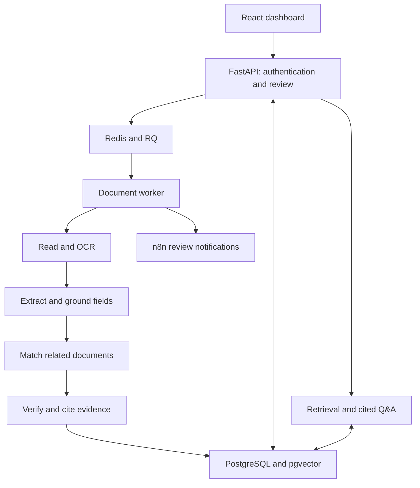

<div align="center">


# Veritas AI

**Local document intelligence, verification, and human review.**


</div>

Veritas AI reads purchase orders, invoices, contracts, and scanned documents. It extracts
structured data, proposes links between related documents, and flags discrepancies with
supporting evidence. A reviewer makes the final decision.

**Work in progress:** this repository is a development project. Features and evaluations
are evolving; see the [roadmap](docs/ROADMAP.md).

For example, an order requests two pumps and an invoice bills three. Veritas extracts the
quantities, checks the proposed document link, compares the items, and looks for supporting
approval text. The reviewer can inspect the evidence and confirm or dismiss the finding.

## Features

| Area | Implementation |
|---|---|
| Document reading | Text and scanned PDFs, Word, text, and images; OCR through PaddleOCR |
| Extraction | Local Ollama LLM, Pydantic validation, regex and spaCy rules, source grounding |
| Matching | References, party identities, embedded line items, ambiguity handling, audited link corrections |
| Verification | Arithmetic and cross-document rules, NLI claim checking, evidence-backed findings |
| RAG | Document retrieval with pgvector, cited answers, and citation checking |
| Review | Findings, document comparisons, reviewer decisions, and audit events |
| Access control | Cookie sessions, viewer/reviewer/admin roles, organization scoping |
| Processing | Redis/RQ workers, persisted processing state, Alembic migrations |
| Automation | n8n templates for review notifications and reminders |
| Languages | English, French, and Arabic parsing and evaluation work; coverage varies by component |

## Architecture



Models run locally. Initial installation and first use can download dependencies and model
weights. Optional notification integrations may send configured data to external services.

## Quick start

Requirements: Docker Desktop with Compose, Ollama, and enough memory for the selected models.
For local development, use Python 3.12 and Node.js 24 (the version used by frontend CI).

1. Clone the repository and configure your environment:

   ```bash
   git clone https://github.com/Aymanelgr/veritas-ai.git
   cd veritas-ai
   cp .env.example .env
   ```

   In PowerShell, use `Copy-Item .env.example .env` for the last step.
   Set a strong `POSTGRES_PASSWORD`, update the password in `DATABASE_URL` to match,
   and replace `AUTOMATION_TOKEN` with a long random value. Keep `.env` private.

2. Download the default local LLM:

   ```bash
   ollama pull qwen3:8b
   ```

3. Start the containerized application:

   ```bash
   docker compose --profile app up -d --build
   ```

4. Create the first administrator. The command prompts for a password:

   ```bash
   docker compose exec api python -m backend.manage create-user --email you@example.com --name "Your Name" --role admin
   ```

5. Open the dashboard at **http://localhost:8080** and sign in.
   API documentation is at **http://localhost:8001/docs**; n8n is at **http://localhost:5678**.
   Initial OCR, embedding, and NLI use may download model weights and take longer.

Ollama runs on the host; the containers reach it at `host.docker.internal`. On Linux,
configure this host mapping if your Docker setup does not provide it.

For notification setup, set `VERITAS_API_FROM_N8N=http://api:8000` in `.env` and run
`python scripts/setup_n8n.py` from a configured local Python environment. The workflow
instructions and templates are in `automation/n8n/`. Notifications are optional.

This setup binds exposed ports to localhost. A public hosted deployment needs a separate
HTTPS and operations configuration; uploading the code to GitHub does not host the application.

## Local development on Windows

```powershell
python -m venv .venv
.venv\Scripts\python -m pip install torch --index-url https://download.pytorch.org/whl/cpu
.venv\Scripts\python -m pip install -r requirements.txt
.venv\Scripts\python -m spacy download en_core_web_sm
.venv\Scripts\python -c "import nltk; nltk.download('punkt_tab'); nltk.download('stopwords')"
cd frontend
npm ci
cd ..
.\scripts\start_dev.ps1
```

For a supported NVIDIA installation, use the appropriate PyTorch CUDA wheel instead of
its CPU wheel. The development script starts infrastructure and opens the API, worker,
and frontend processes. Dashboard: **http://localhost:5173**; API: **http://localhost:8000/docs**.

Create your local administrator with the same command as above, replacing
`docker compose exec api python` with `.venv\Scripts\python`.
Database migrations run on application startup; create a migration for schema changes.

## Validation

```bash
python -m pytest -q
cd frontend
npm ci
npm run build
```

Tests use a separate database whose name ends in `_test`. The configured database user
must be able to access it. Tests needing unavailable services can skip; inspect the pytest
summary. LLM-dependent checks require Ollama and the selected model. CI forces the LLM off
and runs the backend with disposable PostgreSQL/pgvector and Redis services.

Generate and inspect synthetic examples:

```bash
python phase2_documents/make_samples.py
python scripts/make_examples.py
python scripts/check_examples.py
```

Binary sample documents are generated locally from the committed text fixtures rather
than stored in Git. The pytest session creates them automatically when they are missing.

Evaluation entry points:

| Component | Command |
|---|---|
| Matching | `python -m phase4_matching.evaluate --seed 99` |
| Verification and NLI | `python -m phase5_verification.evaluate` |
| RAG | `python -m phase6_rag.evaluate` |
| Languages | `python scripts/evaluate_languages.py` |

These datasets are small and largely synthetic. Results demonstrate behavior on those
examples and do not establish real-world accuracy. Run evaluations on the current code and
record dataset and model versions when reporting results.

## Repository guide

| Path | Purpose |
|---|---|
| `backend/`, `db/`, `migrations/` | API, background processing, data model, schema migrations |
| `frontend/` | React/Vite dashboard |
| `phase1_nlp/` through `phase6_rag/` | NLP, reading, extraction, matching, verification, retrieval |
| `automation/n8n/` | Notification workflow templates |
| `data/`, `examples/` | Synthetic fixtures, evaluation sets, example guide |
| `tests/`, `scripts/` | Automated checks and development/maintenance commands |
| `docs/` | Roadmap, build log, and learning notes |

Local uploads, backups, secrets, caches, dependencies, generated examples, and private
implementation prompts are excluded from version control.

## Continuing development

See [CONTRIBUTING.md](CONTRIBUTING.md) for the branch, test, commit, and push workflow.
Keep working in this checkout and push updates when ready.

Learning references: [project notes](docs/Veritas_AI_2_Project_Notes.md),
[build log](docs/Veritas_AI_2_Build_Log.md), and
[tools explained](docs/Veritas_AI_2_Tools_Explained.md). These capture earlier development
stages; the current source and setup instructions above take precedence.
